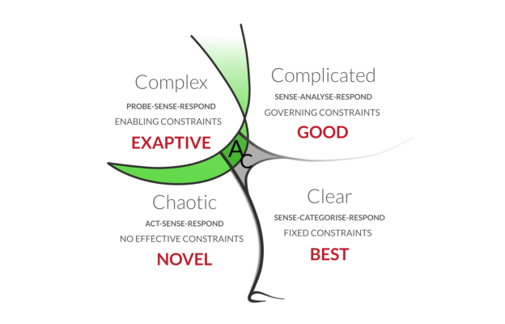
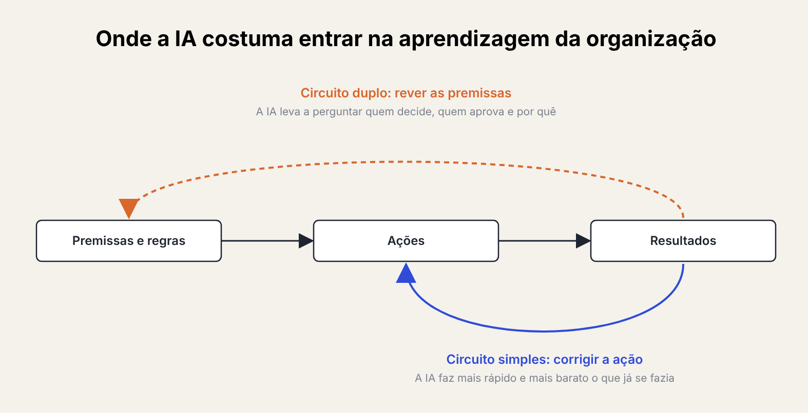
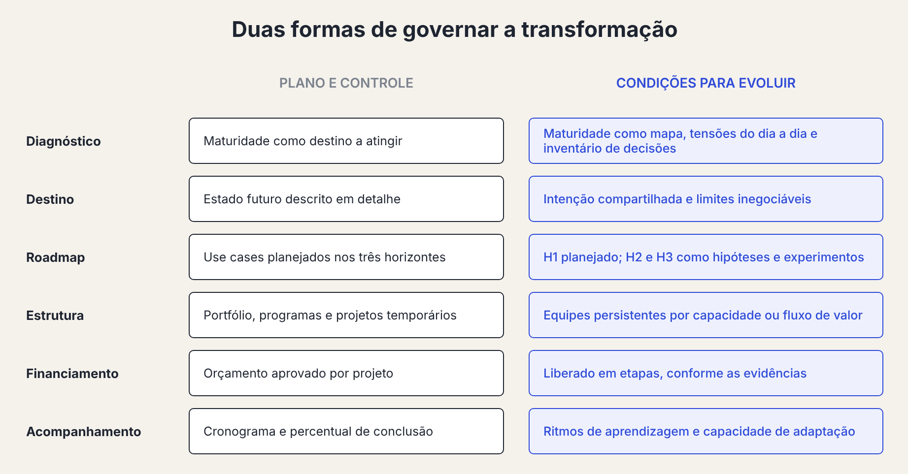

Many companies' digital transformation plans have the same shape as the org chart they were supposed to transform.

I realized this during a class in an executive program on business transformation in the AI era. The cohort brings together people from large, established organizations: banks, an energy distributor, a hotel group, financial services firms and shared services centers. These are companies with decades of history, significant assets, watchful regulators and shareholders who ask for predictability.

The approach presented in class made sense to many of my classmates. Before transforming, you need to know where the organization stands and which indicators should change, the way you'd weigh and measure someone before proposing a diet. Then come the destination and the purpose. The mission and strategy unfold into a roadmap across three horizons, with *use cases* prioritized according to business capabilities and available resources. Portfolios, programs and projects give structure and governance to the whole.

Two IDC maturity models (***IDC Future Enterprise Maturity Assessment*** and ***AI-Fueled Enterprise Maturity Assessment***), one for the digital enterprise and the other for the AI-driven organization, help locate the starting point on a five-level scale, as well as the end point after the "transformation."

It's a coherent, well-grounded approach, close to the reality of the people in the room. That's precisely why it caught my attention. I left class with the impression that this approach treated digital transformation as a complicated problem, when a good part of it is a complex one. And that AI, which could challenge that premise, is being absorbed by it.

## Complicated and complex are different things

The distinction comes from [Cynefin](https://thecynefin.co/about-us/about-cynefin-framework), Dave Snowden's framework for telling decision contexts apart. In a complicated context, the relationship between cause and effect exists and can be discovered through expert analysis. Replacing a billing system, migrating infrastructure to the cloud or complying with a new regulation are problems of this kind: hard and expensive, but decomposable. A good plan, executed with discipline, is enough to get there.

In a complex context, cause and effect only become clear in hindsight. The system reacts to the intervention, the parts influence one another and the outcome emerges from those interactions. Changing the way people decide, collaborate and take responsibility when a technology alters their work is a problem of this kind. You can create conditions, observe what happens and adjust, but the outcome can't be guaranteed through decomposition.

*Cynefin framework - Dave Snowden*

A digital transformation mixes both contexts. The ERP migration is complicated, while the culture change that should go with it is complex. Cynefin distinguishes situations. It would be a mistake to use it to classify entire companies, as if large organizations were complicated and startups were complex.

The problem I see lies in governing the entire transformation with the tools of the complicated domain, as if the complex part were just one more work package to plan.

## Why the plan-and-control model makes so much sense

I kept wondering why this model resonates so strongly in established organizations. I have three hypotheses. Each of them finds support in well-known theories from psychology and the sociology of organizations.

The first is **protection**.

Those who have a lot to lose prefer predictability, and a detailed plan offers the feeling that risks are under control. Part of this caution is legitimate, because the cost of a mistake in critical infrastructure is asymmetric. Another part is what psychologist Ellen Langer called the ***illusion of control***: the tendency to overestimate our ability to control outcomes that depend on factors beyond our reach.

The second is **legitimacy**.

Transformation investments have to be approved by boards, justified to shareholders and defended before auditors, and a plan with horizons, milestones and indicators is the language those bodies recognize. John Meyer and Brian Rowan showed, back in the 1970s, that organizations adopt formal structures largely because they confer ***legitimacy in the eyes of their environment***, and that the real work is often decoupled from those structures. The plan also serves a ceremonial function, which has value of its own even when it isn't followed to the letter.

The third is **imitation**.

Paul DiMaggio and Walter Powell called institutional isomorphism the tendency of organizations in the same field to become more and more alike. Under uncertainty, they copy whoever seems successful. Under pressure from regulators and investors, they adopt the required formats. And, through the normative route, they receive the same models from the same consultancies, certifications and business schools. The class, with its maturity models and roadmap frameworks, is part of that mechanism. I was there too.

The three hypotheses explain why the model is adopted, but none of them shows that it is effective for the problem it aims to solve.

## The roadmap mirrors the org chart

What bothered me most was a resemblance in shape. The hierarchy of strategy, portfolio, program and project fits almost perfectly into the traditional org chart. Strategy sits with the board and the CEO, the portfolio with the executive team, each program with a division director, each project with a manager and the *use cases* with the teams.

*Conway's Law (1968): systems tend to reproduce the communication structure of the organization that creates them.*

In 1968, programmer Melvin Conway observed that the systems an organization creates tend to reproduce that organization's communication structure. The observation became known as [Conway's Law](https://en.wikipedia.org/wiki/Conway%27s_law) and is usually applied to software. I think it also holds for planning: **the transformation plan reproduces the power structure of whoever drafts it**.

The consequence is a kind of self-reference.

The organization uses its own structure to describe its future, and that's why the future it describes looks a lot like the present. The plan may change what the organization does, with new digital channels, automated processes and integrated data, but it tends to preserve how it decides: who approves, who funds and who answers for what.

One of the slides in class helps show the size of the issue. It listed the five biggest blockers to digital transformation according to a 2017 survey:

- leadership and legacy culture
- outdated metrics
- organizational silos
- lack of skills
- lack of tactical planning

None of the five is technological. If the same obstacles have persisted for a decade, I suspect the structure used to remove them is part of them.

## AI comes in as one more box

It would be reasonable to expect AI to change this picture. A technology capable of redistributing information, analysis and even decisions should, in theory, challenge the hierarchy that concentrates those things at the top.

However, the AI maturity model presented in class suggests the opposite, at least at the first levels.

At level two, the organization creates an AI oversight function and a leader in charge of developing the roadmap. At level three, the AI strategy comes to be sustained by a center of excellence. The organizational response to the new technology is to add boxes to the org chart. Only at level four does an operating model redesigned around agent-based processes appear, which is precisely the stage few organizations reach.

[Chris Argyris and Donald Schön](https://link.amazon/B0bd6zS2u) distinguished two forms of organizational learning. In single-loop learning, the organization corrects its actions to reach the same goals, without touching its assumptions. In double-loop learning, the assumptions themselves come up for discussion.

*Based on Chris Argyris and Donald Schön, single-loop and double-loop learning*

When AI adoption is driven by the same plan-and-control logic, it tends toward the single loop. The organization gains execution capacity, does what it already did faster and cheaper, and keeps deciding the same way.

The question that seems most important to me for these companies rarely shows up in roadmaps: what should AI change in the way they govern themselves?

## What plan and control does well

Everything I've observed so far has its limits.

The first is that **plan and control serve real functions**.

At an electricity distributor, an experiment that goes wrong on the grid can leave a whole region without power. At a bank, regulation requires decision traceability and demonstrable controls. Coordinating thousands of people and allocating capital across dozens of initiatives calls for some degree of formal structure. Arguing that these organizations should abandon planning would be naive.

The second limit is **my own context**.

I come from a [software company](https://atelie.software) built on self-management, where experimenting and distributing decisions is much simpler than in an organization with tens of thousands of people, and that shapes what I see. The honest question is **how a complexity-oriented approach scales**. The examples of large organizations that pulled it off, like [Haier](https://www.forbes.com/sites/stevedenning/2022/01/30/can-firms-succeed-without-managers-the-case-of-haier/) and [Buurtzorg](https://www.library.hbs.edu/working-knowledge/this-company-lets-employees-take-charge-buurtzorg), are cited often precisely because they are rare.

The third is that **the model presented itself acknowledges part of the problem**.

The blockers slide is, in a way, a self-critique of the plan-and-control paradigm, and levels four and five of the maturity scales **describe cultural shifts and redesigned operating models**. The disagreement is less about the destination and more about the path to it.

That's why the thesis I can defend is narrower than the impression I left class with. The problem lies in using plan and control as the only way to govern the transformation, including in the parts where it doesn't work.

## Governing the conditions for transformation

If transformation mixes complicated and complex problems, governance needs to recognize that mix.

The technical migration, regulatory compliance and infrastructure modernization are still well served by projects, schedules and milestones. The complex part calls for a different kind of instrument, and it becomes clearer when we follow, step by step, the same sequence presented in class.

*The complicated part of the transformation is still well served by projects. The complex part calls for the model on the right.*

The **diagnosis** is still the first step, but its function changes.

Maturity models help you know where the organization stands, as long as they serve as a map and stop being the destination. Added to them are a survey of the tensions people experience at work, such as rework, waiting and approvals nobody can justify, and an inventory of the decisions the organization makes, another idea presented in class. That inventory shows who decides what, and it's from there that you discuss which decisions AI can take on and which should move closer to whoever has the information.

The future state gives way to **an intent and boundaries**.

Leadership defines the direction and the why of the transformation, instead of describing in detail what the organization will look like three years from now. It also sets the non-negotiable boundaries, such as safety, regulatory compliance, risk appetite and maximum budget. Within those boundaries, teams are free to propose and test.

The roadmap becomes a **portfolio of bets** with different treatments.

The three horizons are still useful, but each one is governed differently. The first, closer to the complicated domain, accepts planning, schedules and detailed *use cases*. In the second and third, initiatives are framed as hypotheses and tested in small experiments, with criteria defined in advance to expand, adjust or shut down each one.

Temporary projects give way to **persistent teams**.

The organization keeps teams responsible for a capability or a value stream, such as customer experience or asset management, instead of setting up a project, delivering it and disbanding the team. Funding follows the same logic and is released in stages, as evidence appears. Mik Kersten develops this proposal in [Project to Product](https://link.amazon/B040s0eQS).

The steering committee gives way to **learning rhythms**.

Every week, teams look at what's happening and remove impediments. Every four to six weeks, they review hypotheses and redistribute capacity among the bets. Every quarter, leadership reassesses the direction, the boundaries and the governance mechanisms themselves.

What gets **measured** also changes.

Percentage complete and schedule adherence say little about the complex part. The time between noticing a problem and deciding what to do, the share of decisions made close to whoever has the information, and the hypotheses validated or refuted say more.

## An example

Imagine a services company that wants to use AI to improve customer service.

Under the plan-and-control approach, it would run the maturity assessment, set a target of reducing response time by a certain percentage, create a customer experience program and break it down into projects: a new CRM, a virtual assistant and the automation of request triage. Each project would have a budget, a schedule and a manager, and success would be measured by deliverables.

Under the alternative proposal, it would start from a tension: **why are customers still dissatisfied after everything that has already been invested in technology?**

The decision inventory might show that a good share of requests wait days for a supervisor's approval, even when the answer is predictable. The company would then test three small interventions in parallel:

- Give one team the autonomy to resolve requests up to a certain amount without approval
- Use AI to suggest responses with human review
- Eliminate a handoff of responsibility between two departments

After a few weeks, it would scale what worked and shut down the rest.

Perhaps the most useful discovery would be that the biggest gain came from the autonomy given to the team, more than from the virtual assistant. In a closed plan, that discovery would hardly have surfaced, because nobody had a project for it.

The example also shows **the place governance comes to occupy**.

In a double-loop transformation, approval rules, funding criteria and the distribution of authority fall within the scope of what can change. Governance stops being only the mechanism that oversees the transformation and also becomes its object. That's why, before automating an approval flow with AI, it's worth asking why that approval exists and who gains from it.

## Food for thought

- If you put your transformation roadmap next to your company's org chart, how many boxes in the plan are owned by someone who already ran that area before it?
- Among the AI initiatives underway, which one has changed who decides something, beyond how fast decisions are made?
- What approval rule, funding criterion or way of measuring results would your organization be willing to put to an experiment in the coming months?
