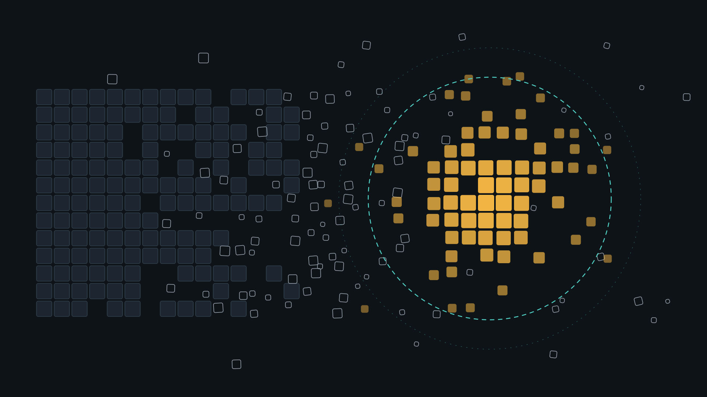
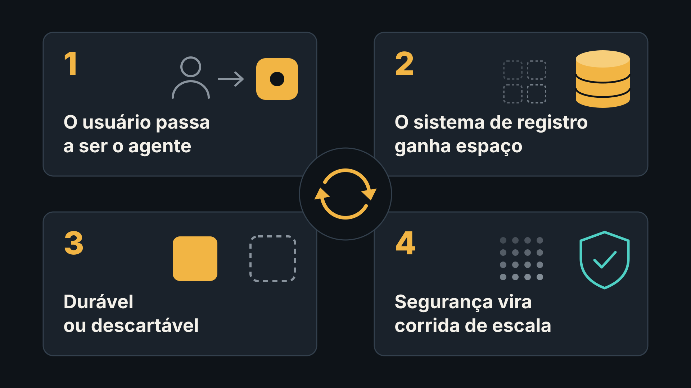
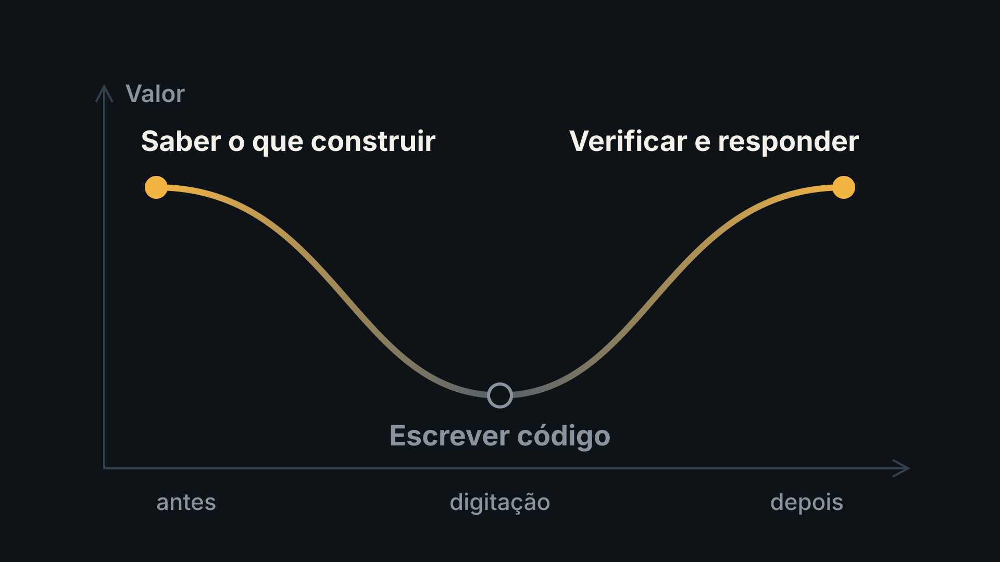

*Where does value go when code gets cheap?*

Software development isn't ending. Writing code got cheap, and value is moving to what is still expensive: **knowing what to build, verifying what was built, making sure it is secure** and **answering for it when it fails**.

The public conversation about AI and software tends to get stuck on a very narrow question: "*How many developers will AI replace?*". This piece tries to take a more systemic view.

When the cost of producing software collapses, several things change at once: **who builds** (more and more, the users themselves), **who uses** (more and more, agents instead of people), **where the risk lies** (in an unprecedented security race) and **who captures the value** (the owners of data and context).

I write as someone who has [made a living building software for others for more than 20 years](https://www.ateliedesoftware.com.br/) and who is still trying to understand what lies ahead. My starting point is an essay by [Ben Thompson](https://www.linkedin.com/in/benjaminjthompson/) that, while discussing the [end of the open internet](https://stratechery.com/2026/the-end-of-the-internet/), precisely describes software's new place: smaller, more private, more numerous and more exposed.

## The end of the internet as we knew it

The internet where anyone could put a server online and join the network on equal footing is over. That is Thompson's thesis, and it rests on changes that matter to anyone who makes software.

**Attacks no longer have a human limit.** All the software we use was built on a foundation written by people, where the deciding question was always "*does it work?*", not "*can it withstand every possible attack?*". That was tolerable because attackers were also limited by time and human ingenuity. AI removes that limit: it has unlimited time and can trade cleverness for iteration.

**Staying exposed is no longer worth it.** AI reads published content and answers the question right there in the conversation, without sending back the traffic search engines used to send. Keeping your own website or app exposed, which was the network's great promise, becomes reckless: you pay for the infrastructure and the defense without the audience that justified the risk.

**Software shrinks (this is the optimistic part).** Just as blogs survived by shrinking into niche subscriptions, and social networks retreated into messaging groups, software will shrink too. Software always had zero marginal cost, but it required so much upfront effort that it only made sense for large audiences. AI flips that math: it becomes worth building software for one person or one team.

## The economics of cheap code

When an input gets much cheaper, two things happen at the same time: whoever sold that input loses pricing power, and new demand emerges. Code is going through both.

**Those who sell effort (hours) to deliver code are already feeling the drop.**

This is the part we can already state with confidence. At India's IT services giants, such as TCS and Infosys, the expression "*AI deflation*" has made its way into earnings reports. AI-related revenue is growing fast, close to 30% in a single quarter at Infosys, while total revenue grows about 1%, because traditional work is shrinking almost as much. Accenture, which is still growing, acknowledged that prices have fallen in many areas and that it is passing AI-driven productivity on to clients. Everyone rents the same models, and competition hands the savings back to the client.

**At the same time, new demand appears.**

This is the Jevons paradox: more efficient steam engines made England burn more coal, not less. Modernization projects that didn't pay off start paying off, and software that never existed before emerges, built for a team or for a single person.

The two forces don't cancel each other out symmetrically, and that's the most important part. New demand doesn't necessarily go to those who lost the old one. Much of the small software will be built by the users themselves, and part of the modernization by in-house teams amplified by agents.

The total value created may grow a lot, while the value captured by those who sell effort shrinks. Whether the new demand will make up for the old one is still a bet.

## Four movements that reinforce each other

It seems that what's happening isn't "*AI writes code faster*". It's a reorganization of who uses software, who builds it and where the value ends up.

*4 movements that are redefining software development*

### 1. The main user is no longer human

For 25 years, enterprise software started from one premise: the user is a person clicking on a screen. In April 2026, Salesforce announced Headless 360, which exposes the platform as APIs and tools so that agents can work without opening a browser. The human interface becomes the place to set goals, approve decisions and handle exceptions.

### 2. The system of record gains ground

ZoomInfo saw small companies canceling point solutions four times more than a year earlier, while the systems that hold business data are holding up. Agents need context, and context lives in the system of record and in knowledge bases. Among large companies, cancellations haven't shown up yet, so the size of this movement remains uncertain.

### 3. Software splits into durable and disposable

On one side, code built to solve a problem and be thrown away, more and more by the users themselves. On the other, code that supports data, money and people and requires a different engineering standard. The difference isn't who wrote it, human or machine, but the life cycle and the cost of a failure. The risk is that disposable code quietly becomes part of an important process: production software that nobody understands end to end and nobody owns.

### 4. Security becomes a race of scale

Thompson's warning comes with numbers. In Anthropic's Project Glasswing, a model found thousands of candidate vulnerabilities in open source projects. Weeks later, only about 6% of those already reported to maintainers had a published fix. Finding flaws has become a problem of scale, but fixing them is still a human problem. Whether defensive agents will close that gap over time is, for now, a bet.

Together, these movements draw the map: data and systems of record at the bottom, agents executing in the middle, people deciding on top, small private software at the edges, and security cutting across everything.

## What is still expensive

If writing code gets cheap, value moves to what is still expensive, and everything that is still expensive happens before or after the coding.

*Where the value of software development lies*

1. **Knowing what to build:** A prototype is no longer proof of competence: the client shows up to the meeting with an app built on a Sunday. What remains rare is translating an ambiguous business need into a precise specification, and deciding what not to build.
2. **Verifying:** AI acts as an amplifier: it speeds up those who already have good engineering and exposes the mess of those who don't. Some developers still say they have little or no trust in generated code. Testing, review, observability and agent evaluation stop being support steps and become the center of the work.
3. **Context:** Agents produce only as much as the context they receive. Business data, unwritten rules, the history of decisions and integrations with legacy systems are what separate a useful agent from a generator of plausible code.
4. **Answering for the result:** An agent doesn't sign contracts or answer to a regulator. The buyer's question is no longer "*can you build it?*" but "*will you answer for it when it breaks?*".

## The front door is closing

The most reliable data so far doesn't show mass unemployment among developers. It shows something subtler and perhaps more serious.

A Stanford study using U.S. payroll data shows the following: among young people aged 22 to 25, employment in the occupations most exposed to AI, programming among them, is about 19% below where it would be if it had kept pace with the least exposed occupations. The adjustment comes less from layoffs and more from openings that were never created. The study shows the pattern without proving the cause, but it shows up precisely where AI already does the task on its own.

The problem appears when you look at the other end. Seniors are made by doing junior work for years: writing tests, fixing small bugs, reading other people's code. If that work goes to agents and entry-level jobs disappear, the industry burns through its own stock of experience without replenishing it. Nobody knows yet how to grow a senior in a world without junior tasks.

## What this changes in practice

The systemic view changes the question. It's no longer "*will AI replace those who write code?*", but "*where on this map is a software services company still needed?*". What follows are directions, not certainties.

- **For those who buy software:** The decision between subscribing, hiring and building in-house with agents is back on the table, because building got cheap. Maintaining, fixing and defending did not. It's worth knowing how much disposable software already supports your company's processes and who answers for it. And it's worth not tying your operation to a single model.
- **For those who lead engineering:** Investment moves away from typing and toward specification, verification and context: testing, review, agent evaluation and business knowledge organized so that both people and agents can read it. You need to treat the product, not the project, as the unit of work. Developers stop being the ones who type and become the ones who orchestrate. Growing seniors becomes a work design problem, and those who stop hiring beginners now risk competing later for professionals who are increasingly scarce.
- **For those who build software for others:** Clients will build disposable software on their own, and large vendors will dominate systems of record. In between lies durable, custom software for a specific organization: few users, but data, money and processes at stake. In that space, you sell verified results instead of coding hours, and responsibility continues after delivery. Buyers are still learning to buy this way.

The end of the open internet may be the beginning of many small markets. For those who make a living from software, that's good news, as long as we accept that the product is no longer the hour of work, but the trust in and the value of what we deliver.

## Sources

- [Ben Thompson, The End of the Internet (Stratechery, Oct. 2026)](https://stratechery.com/2026/the-end-of-the-internet/)
- [The Register, 'AI deflation' comes to India's tech services giants](https://www.theregister.com/software/2026/04/28/ai-deflation-comes-to-indias-tech-services-giants/5225686)
- [Infosys, earnings call for Q2 of fiscal year 2027](https://www.infosys.com/investors/reports-filings/quarterly-results/2026-2027/q2/documents/transcripts/earningscall.pdf)
- [Yahoo Finance, What Would It Take For AI Price Cuts To Break Accenture Stock?](https://finance.yahoo.com/technology/ai/articles/ai-price-cuts-break-accenture-183050311.html)
- [Salesforce, Introducing Salesforce Headless 360](https://www.salesforce.com/news/stories/salesforce-headless-360-announcement/)
- [KEYT/Stacker, The SaaSpocalypse is real, if you're not a system of record (ZoomInfo data)](https://keyt.com/stacker-business-economy/2026/10/12/the-saaspocalypse-is-real-if-youre-not-a-system-of-record/)
- [Cloud Security Alliance, Project Glasswing: AI Discovery Outpaces Open Source Patching Capacity](https://cloudsecurityalliance.org/artifacts/project-glasswing-ai-discovery-outpaces-open-source-patching-capacity)
- [DORA 2025, State of AI-assisted Software Development](https://services.google.com/fh/files/misc/2025_state_of_ai_assisted_software_development.pdf)
- [The Register, AI coding tools make developers slower but they think they're faster (METR study)](https://www.theregister.com/2025/07/11/ai_code_tools_slow_down/)
- [Stanford Digital Economy Lab, Canaries in the Coal Mine?, August 2026 revision](https://digitaleconomy.stanford.edu/news/canariesaug26/)
- [Anthropic, announcement on access to the Fable and Mythos models](https://www.anthropic.com/news/fable-mythos-access)
