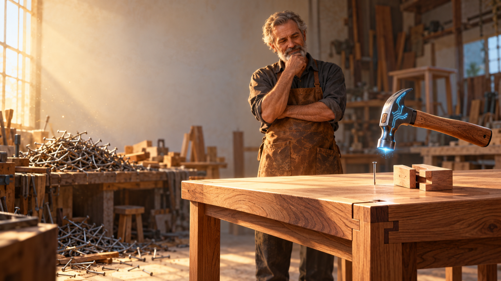

*The carpenter watching the AI-powered hammer.*

Imagine a carpenter building a table at a time when the hammer didn't exist yet.

To join two pieces of wood, he had to improvise. Maybe he used a stone or a piece of wood as a club to drive in the nails. He could build the table, but the task took more effort, more time and offered less precision. One bad blow could bend the nail or damage the wood.

Then someone invented the hammer.

With a proper tool, nailing became easier, faster and more precise. The carpenter could now do the same task more effectively and efficiently, putting in less effort and getting better results.

For a long time, the hammer was a tool with a simple function: hitting nails. It was up to the carpenter to decide where to nail, how many nails to use, the best way to join the pieces and whether the structure would hold the weight.

Now imagine that this hammer gained artificial intelligence.

It can still drive nails, but it can also assess whether the nail is really necessary, where it should go, how many will be enough and whether that joint will bear the expected weight. It might even realize that, in this case, a wood joint would be a better solution.

This hammer is no longer just a tool for execution. It has taken on the characteristics of an agent, able to analyze a situation, make decisions within certain limits and take actions to reach a goal.

And here an interesting question comes up: if the hammer has changed so much, why should the carpenter's work stay the same?

Organizing the workshop around every nail driven makes less and less sense. The carpenter can devote his attention to the table he wants to build, to who will use it, to the choice of materials and to the quality of the structure. He also gains a task that didn't exist before: defining how far the hammer decides on its own and at what point the decision comes back into his hands. That way, he can make more tables in less time, with more quality and even with fewer nails.

But imagine the workshop keeps measuring productivity by the number of nails driven per day. The smart hammer would produce impressive numbers. We could celebrate 300% more nails while the number of finished tables stays practically the same.

Worse still, the extra nails might create more inspection, correction and finishing work.

I believe something similar is happening with artificial intelligence in software development.

We're putting ever more capable tools in developers' hands, but we keep organizing much of the work as if these people's main responsibility were writing code.

We celebrate more lines of code, more commits, more pull requests and more agents working in parallel. At the same time, we face bottlenecks in review, integration, testing, maintenance and delivery.

> Perhaps we're using AI agents to drive more nails, when we should be rethinking the way we build tables.

This also transforms the developer's role. Their responsibility increasingly centers on understanding problems, defining expected outcomes, making architectural decisions, coordinating human and agentic work, and making sure the solution delivered actually works and creates value.

The organization needs to change too. The division of labor, the way people collaborate, quality criteria and decision-making mechanisms were designed for a time when execution was the scarce resource. Having intelligent agents is only one part of the transformation; the rest lies in redesigning everything around them.

The real transformation AI brings may lie less in the speed at which we carry out the activities we already know and more in the possibility of reorganizing work around capabilities that didn't exist before.

After all, the carpenter's goal was never to drive nails. It was to build good tables.

And the goal of software development was never to write more code, but to solve problems and create value through software.
