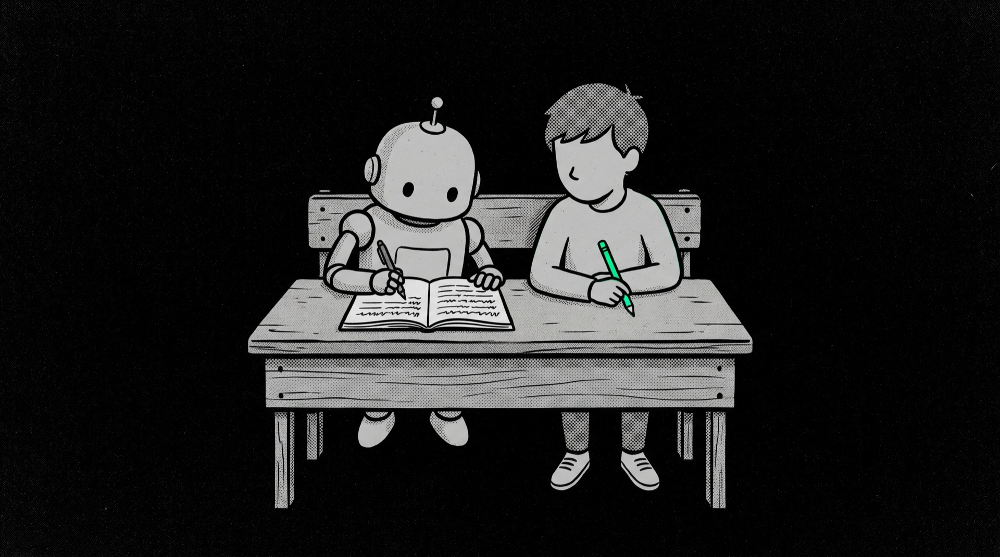
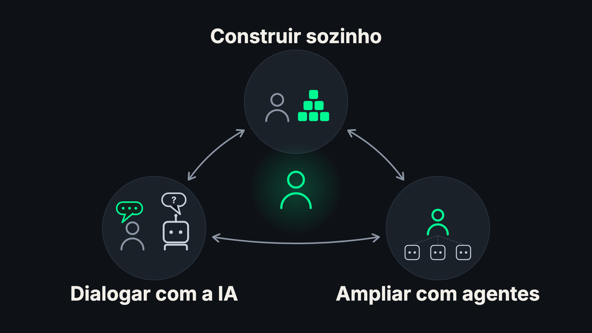

For a long time, schools could rely on a simple equivalence: whoever did the task learned from it.

Learning math meant solving problems. Learning to write meant writing. To produce a good essay, a student had to research, select information, organize ideas, build arguments and revise what they had written. Each step was an opportunity to grow, and the essay handed in was proof that the path had been walked.

**Artificial intelligence breaks that equivalence**. Today a student can hand in a great essay in minutes without having exercised almost anything the essay was supposed to develop. The quality of what a student produces is no longer necessarily a good measure of what they know or are able to do.

There is, however, an important paradox: **the same technology that can weaken certain human capabilities can also offer extraordinary opportunities to develop them**. The difference lies in how we use it, when we introduce it and, above all, which learning experiences we decide to preserve.

I look at this question from two places. The first is [Escola Lumiar Poços de Caldas](https://www.escolalumiarpocos.com.br/), a school I helped found in 2018. It follows the Lumiar Methodology, which breaks with grouping children by age and with a curriculum split into subjects, organizes learning around projects guided by Tutors and Masters, and treats autonomy as the ultimate goal of education. The second place is the classroom in graduate and MBA programs, where I teach adults who arrive with years of professional experience. AI raises the same question in both places, but with different weights.

## Doing the task and learning from it

It helps to separate three things that schools used to treat as one. Performance is being able to do a task well. Learning is what remains after the task is over. Formation is what those experiences produce in autonomy, judgment and values.

*In the age of AI, learning and formation go far beyond performance*

There is already experimental evidence that the first two can move in opposite directions. A study [published in PNAS in 2025](https://doi.org/10.1073/pnas.2422633122) followed nearly a thousand high school students in Turkey in math classes. Those who practiced with an interface similar to ChatGPT performed 48% better than the group without AI during the exercises. However, when the tool was taken away, those same students did 17% worse on the exam. A third group used a tutor set up to give hints instead of answers, and the negative effect was largely avoided, although that tutor didn't significantly improve exam results without AI either.

This study shows a specific risk: **replacing the cognitive activity that learning depends on with the automatic production of answers**.

Cognitive psychology has been studying for decades why that effort matters. Henry Roediger and Jeffrey Karpicke showed that trying to retrieve something from memory produces longer-lasting retention than simply rereading the material, a phenomenon known as the *testing effect*. **Making mistakes, rebuilding a line of reasoning and explaining something in your own words** look like unproductive activities, but they are exactly the ones that teach.

Formative effort helps you learn, while any unnecessary effort only creates frustration and wastes time. Education doesn't need to preserve every difficulty, but it does need to preserve the one that teaches.

## Delegating before knowing

Offloading mental work to external tools is an old habit. We use planners, calculators, maps and search engines (the literature calls this *cognitive offloading*). What's different about generative AI is how much we can delegate: beyond remembering and calculating, it interprets, synthesizes, argues and draws conclusions.

An experienced professional, like the ones I meet in my MBA classes, uses AI to amplify capabilities they have already developed. A child who uses AI before developing those capabilities runs the risk of becoming dependent without ever having built the competence.

A [study by Microsoft Research and Carnegie Mellon](https://www.microsoft.com/en-us/research/wp-content/uploads/2025/01/lee_2025_ai_critical_thinking_survey.pdf), published in 2025 with 319 professionals, found **an association between more confidence in AI and less self-reported critical thinking in AI-assisted tasks**. These are adults reporting their own perception, which proves nothing about children, but it points to a plausible mechanism that deserves investigation.

There is also an effect on metacognition: **the ability to recognize what we know and what we don't**. When a person faces a problem alone, the difficulty reveals the limits of their own knowledge. With AI, the result can show up before that awareness does. The student produces a convincing explanation and comes to believe they understood the subject, while the gap between perceived competence and actual competence grows without them noticing.

The same reasoning extends to moral development. Imagine a teenager who, after a fight with a friend, asks AI who is right and what they should reply. The tool may offer a balanced interpretation and even suggest a thoughtful message. Getting a reasonable answer, though, is different from learning to form your own judgment, which requires noticing the conflict between values, considering the other person's perspective, tolerating ambiguity and owning the consequences of the decision.

Philosopher [Shannon Vallor called it moral deskilling](https://bhaven.org/uploads/3/4/0/3/34038663/vallor2015_article_moraldeskillingandupskillingin.pdf): the weakening of moral capabilities when technology replaces the experiences that exercise them. She wrote about it in 2015, before generative models, but she also recognized that technology can develop new moral skills. We have philosophical grounds for concern, but **we still don't have longitudinal evidence that talking to AI harms children's moral development**.

## What the counterarguments say

There are good arguments in the opposite direction. Many school activities are done mechanically, like copying pages, repeating procedures already mastered or producing assignments just to meet requirements. If AI removes part of that work and the student uses the time it frees up to compare hypotheses and debate ideas, they may learn more. What decides is where that time goes.

AI can also do exactly what we were afraid of losing. **Used as a Socratic interlocutor, it questions a claim, asks for evidence, presents an opposing interpretation and points out an inconsistency in reasoning**. Gregory Kestin and colleagues [published in Scientific Reports, in 2025](https://www.nature.com/articles/s41598-025-97652-6), an experiment with Harvard physics students in which an AI tutor built on pedagogical principles allowed them to learn more, in less time, than the active learning class used for comparison.

The most recent review on the subject, [published by the Stanford SCALE Initiative](https://scale.stanford.edu/ai/evidence-base-review/evidence-base-ai-k12-november-review) in November 2026, paints a picture consistent with both sides. **AI looks most promising when it helps students understand new material, practice and get feedback, but it can reduce learning when it is used to outsource the work**. The same review acknowledges that it is still unknown whether the gains persist in the long run, and that few studies deal with children and teenagers.

Then there is the question of access. A child without support at home or without a private tutor can get personalized explanations at any time, and restricting the tool in the name of autonomy could hurt precisely those with fewer resources. But inequality can reappear in another form. Two students with access to the same AI agent can get very different things out of it: someone with a solid foundation knows how to ask questions, challenge answers and check information, while someone with a weaker background tends to accept whatever the tool presents. AI can, at the same time, democratize access to knowledge and widen the inequality of intellectual autonomy.

The risk lies less in delegating tasks as such and more in delegating processes the student still needs to experience in order to learn.

## A problem that goes beyond school

A few days ago, [writing about the future of software development](/en/articles/the-future-of-software-development-in-the-age-of-ai/), I left a question unanswered. Senior professionals are formed after years of doing junior work. If that work goes to agents, how does a senior get formed?

Education faces the same question on a larger scale. Many competencies were developed through gradual participation in activities of increasing complexity, and fully automating the early stages removes part of the experiences through which beginners used to learn.

Human factors research has known this pattern for more than forty years. In 1983, Lisanne Bainbridge described the "ironies of automation": **the more the automated system takes over the work, the less the operator practices the skills they will need precisely when the system fails**.

With AI, that irony may leave the control room and reach society as a whole. It is a possible problem of competence reproduction: a society able to produce sophisticated results may become progressively dependent on systems that it is less and less able to understand, verify or replace.

This is still a hypothesis, especially over a horizon of decades. Even so, it deserves a place in the design of schools and organizations right now.

## What is worth preserving

Before discussing which activities we should or shouldn't delegate to AI, there is an earlier question:

> Which human capabilities do we want future generations to develop, even when they are no longer strictly necessary to get tasks done?

Think about writing. Perhaps, before long, a person will be able to communicate well their whole life without ever writing a complex text on their own. Even so, learning to write is worth it, because writing is also a way of thinking, organizing ideas, dealing with ambiguity and building a voice of your own. The same goes for math, scientific inquiry and argumentation. **Some competencies may stop being economically necessary and still remain humanly valuable**.

If the only criterion is practical usefulness in an automated world, we may end up eliminating experiences that are fundamental to human development. And there is an irony in that: the more AI agents decide, create and execute for us, the more important the human ability to understand, question, choose and take responsibility may become.

In practice, this calls for a school that deliberately alternates between three ways of learning. In the first, **students build their own capabilities**: they observe, write, investigate and solve problems on their own. In the second, **they learn in dialogue with AI**, which questions, gives hints and offers counterarguments, while they remain responsible for the reasoning and the conclusions. In the third, **they use agents to research, automate and create complex products**, and focus their effort on defining the problem, weighing alternatives and answering for the result. The mix depends on age, on what the student already knows and on the goal of each moment.

*The virtuous cycle of education amplified by artificial intelligence*

Assessment changes too. If the final product no longer proves learning, we need to **look at the process, how the arguments evolved, the choices made and the ability to carry knowledge into new situations**. A project can use AI at several stages and end with each student explaining, without help, what they learned, how they changed their mind and which decisions they can justify. This design is familiar to anyone who works with project-based learning, as at Lumiar. AI expands the possibilities, and the student keeps living through the inquiry, the collaboration and the decisions.

The big question for education in the age of AI may stop being only how to prepare students for a world in which machines do more and more things, and come to include how to **form people capable of preserving and developing their humanity in a world where they need to do fewer and fewer things out of necessity**.

If a child always has at hand an intelligence capable of answering their questions, solving their difficulties and guiding their decisions, what experiences will we need to create intentionally so that they develop their own intelligence, their own judgment and their own moral conscience?
