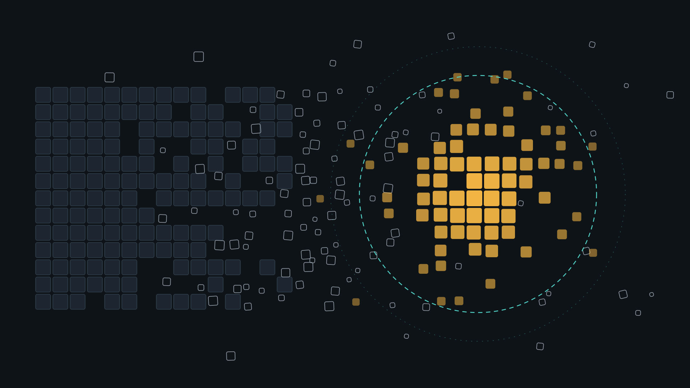
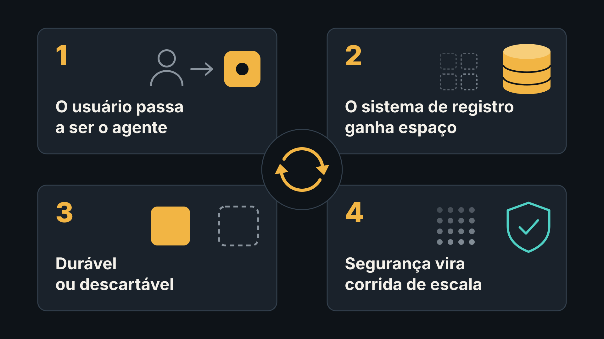
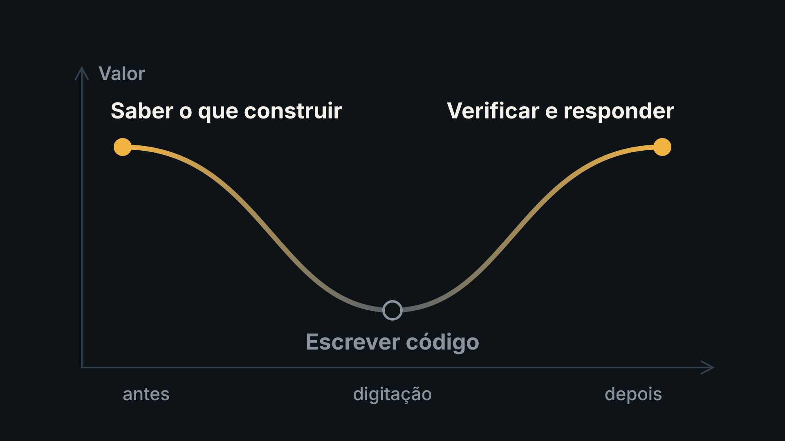

*Para onde vai o valor quando o código fica barato?*

O desenvolvimento de software não está acabando. Escrever código ficou barato e o valor está migrando para o que continua caro: **saber o que construir, verificar o que foi construído, garantir que é seguro** e **responder por ele quando falhar**.

A conversa pública sobre IA e software costuma ficar presa a uma pergunta muito estreita: "*Quantos desenvolvedores a IA vai substituir?*". Este texto procura trazer um olhar mais sistêmico.

Quando o custo de produzir software despenca, mudam ao mesmo tempo **quem constrói** (cada vez mais o próprio usuário), **quem usa** (cada vez mais agentes em vez de pessoas), **onde está o risco** (numa corrida de segurança sem precedentes) e **quem captura o valor** (os donos de dados e de contexto).

Escrevo como alguém que [vive de construir software para os outros há mais de 20 anos](https://www.ateliedesoftware.com.br/) e que ainda está tentando entender o que vem pela frente. O ponto de partida é um ensaio de [Ben Thompson](https://www.linkedin.com/in/benjaminjthompson/) que, falando do [fim da internet aberta](https://stratechery.com/2026/the-end-of-the-internet/), descreve com precisão o novo lugar do software: menor, mais privado, mais numeroso e mais exposto.

## O fim da internet como a conhecíamos

A internet em que qualquer pessoa podia colocar um servidor no ar e fazer parte da rede em pé de igualdade acabou. Essa é a tese de Thompson, e ela se apoia em mudanças que interessam a quem faz software.

**Os ataques deixaram de ter limite humano.** Todo o software que usamos foi construído sobre uma base escrita por pessoas, em que a pergunta decisiva sempre foi "*funciona?*", e não "*resiste a todo ataque possível?*". Isso era tolerável porque os atacantes também eram limitados pelo tempo e pela engenhosidade humana. A IA remove esse limite: tem tempo ilimitado e pode trocar esperteza por iteração.

**Já não vale a pena ficar exposto.** A IA lê o conteúdo publicado e responde à pergunta na própria conversa, sem devolver o tráfego que os buscadores devolviam. Manter o próprio site ou aplicativo exposto, que era a grande promessa da rede, passa a ser uma imprudência: paga-se a conta da infraestrutura e da defesa sem a audiência que justificava o risco.

**O software encolhe (essa é a parte otimista).** Assim como os blogs sobreviveram encolhendo para assinaturas de nicho, e as redes sociais se refugiaram em grupos de mensagens, o software também vai encolher. Software sempre teve custo marginal zero, mas exigia tanto esforço inicial que só se justificava para públicos grandes. A IA inverte essa conta: passa a valer a pena fazer software para uma pessoa ou para uma equipe.

## A economia do código barato

Quando um insumo fica muito mais barato, duas coisas acontecem ao mesmo tempo: quem vendia o insumo perde preço e o surgimento de uma nova demanda. O código está passando pelas duas.

**Quem vende esforço (horas) para entregar código já sente a queda.**

Essa é a parte que já dá para afirmar. Nas gigantes indianas de serviços de TI, como TCS e Infosys, a expressão "*deflação por IA*" entrou no vocabulário dos balanços. A receita ligada à IA cresce depressa, perto de 30% num único trimestre na Infosys, enquanto a receita total avança cerca de 1%, porque o trabalho tradicional encolhe quase na mesma medida. A Accenture, que ainda cresce, reconheceu que os preços caíram em muitas áreas e que está repassando aos clientes a produtividade obtida com IA. Todos alugam os mesmos modelos e a concorrência devolve a economia ao cliente.

**Ao mesmo tempo, aparece demanda nova.**

É o paradoxo de Jevons: máquinas a vapor mais eficientes fizeram a Inglaterra queimar mais carvão e não menos. Projetos de modernização que não se pagavam passam a se pagar, e surge um software que antes não existia, feito para uma equipe ou para uma única pessoa.

As duas forças não se anulam de forma simétrica, e essa é a parte mais importante. A demanda nova não chega necessariamente para quem perdeu a antiga. Boa parte do software pequeno será feita pelo próprio usuário, e parte da modernização, por times internos das organizações amplificados por agentes.

O valor total criado pode crescer muito, enquanto o valor capturado por quem vende esforço encolhe. Se a demanda nova compensará a antiga, ainda é uma aposta.

## Quatro movimentos que se reforçam

Parece que o que está acontecendo não é "*a IA escreve código mais rápido*". É uma reorganização de quem usa o software, de quem o constrói e de onde o valor fica.

*4 movimentos que estão redefinindo o desenvolvimento de software*

### 1. O usuário principal deixa de ser humano

Durante 25 anos, o software corporativo partiu de uma premissa: quem usa é uma pessoa clicando numa tela. Em abril de 2026, a Salesforce anunciou o Headless 360, que expõe a plataforma como APIs e ferramentas para que agentes trabalhem sem abrir o navegador. A interface humana passa a ser o lugar de definir objetivos, aprovar decisões e tratar exceções.

### 2. O sistema de registro ganha espaço

A ZoomInfo viu pequenas empresas cancelando soluções pontuais quatro vezes mais do que um ano antes, enquanto os sistemas que guardam os dados do negócio resistem. O agente precisa de contexto, e o contexto mora no sistema de registro e nas bases de conhecimento. Entre as grandes empresas, o cancelamento ainda não apareceu, então o tamanho desse movimento segue incerto.

### 3. O software se divide em durável e descartável

De um lado, código feito para resolver um problema e ser jogado fora, cada vez mais pelo próprio usuário. Do outro, código que sustenta dados, dinheiro e pessoas e precisa de outro padrão de engenharia. A diferença não é quem escreveu, humano ou máquina, mas o ciclo de vida e o custo de uma falha. O risco é o descartável virar, sem ninguém perceber, parte de um processo importante: software de produção que ninguém entende de ponta a ponta e nem assume como seu.

### 4. A segurança vira uma corrida de escala

O alerta de Thompson tem números. No Project Glasswing, da Anthropic, um modelo encontrou milhares de falhas candidatas em projetos de código aberto. Semanas depois, só cerca de 6% das que já tinham sido comunicadas aos mantenedores tinham correção publicada. Encontrar falhas virou um problema de escala, mas corrigir continua sendo um problema humano. Que os agentes de defesa fechem essa distância com o tempo é, por enquanto, uma aposta.

Juntos, esses movimentos desenham o mapa: dados e sistemas de registro no fundo, agentes executando no meio, pessoas decidindo em cima, software pequeno e privado nas bordas e a segurança atravessando tudo.

## O que continua caro

Se escrever código fica barato, o valor migra para o que continua caro, e tudo o que continua caro fica antes ou depois da codificação.

*Onde está o valor do desenvolvimento de software*

1. **Saber o que construir:** O protótipo deixou de ser prova de competência: o cliente chega à reunião com um app feito num domingo. O que continua raro é traduzir uma necessidade ambígua de negócio em uma especificação precisa, e decidir o que não construir.
2. **Verificar:** A IA atua como um amplificador: acelera quem já tem boa engenharia e expõe a desordem de quem não tem. Uma parte dos desenvolvedores ainda dizem confiar pouco ou nada no código gerado. Testes, revisão, observabilidade e avaliação de agentes deixam de ser etapas de apoio e viram o centro do trabalho.
3. **Contexto:** Agentes produzem tanto quanto o contexto que recebem. Os dados do negócio, as regras não escritas, o histórico de decisões e as integrações com sistemas antigos são o que separa um agente útil de um gerador de código plausível.
4. **Responder pelo resultado:** Um agente não assina contrato nem responde perante um regulador. A pergunta do comprador deixa de ser "*vocês conseguem construir?*" e passa a ser "*vocês respondem por isso quando quebrar?*".

## A porta de entrada está fechando

Os dados mais confiáveis até agora não mostram desemprego em massa entre desenvolvedores. Mostram algo mais sutil e talvez mais grave.

Uma pesquisa de Stanford com dados de folha de pagamento americanos mostra o seguinte: entre os jovens de 22 a 25 anos, o emprego nas profissões mais expostas à IA, programação entre elas, está cerca de 19% abaixo do que estaria se tivesse acompanhado o das profissões menos expostas. O ajuste vem menos de demissões e mais de vagas que deixaram de abrir. O estudo mostra o padrão sem provar a causa, mas ele aparece justamente onde a IA já faz a tarefa sozinha.

O problema aparece quando se olha para a outra ponta. Sêniores se formam fazendo, por anos, o trabalho de júnior: escrevendo testes, corrigindo bugs pequenos, lendo código alheio. Se esse trabalho vai para os agentes e as vagas de entrada somem, a indústria consome o próprio estoque de experiência sem repô-lo. Ninguém sabe ainda como se forma um sênior num mundo sem tarefas de júnior.

## O que isso muda na prática

A leitura sistêmica muda a pergunta. Não é mais "*a IA vai substituir quem escreve código?*", mas "*em que lugar desse mapa uma empresa de serviços de software ainda é necessária?*". O que segue são direções, não certezas.

- **Para quem compra software:** A decisão entre assinar, contratar e construir internamente com agentes volta à mesa, porque construir ficou barato. Manter, corrigir e defender não ficou. Vale saber quanto software descartável já sustenta processos da empresa e quem responde por ele. E vale não prender a operação a um único modelo.
- **Para quem lidera engenharia:** O investimento sai da digitação e vai para especificação, verificação e contexto: testes, revisão, avaliação de agentes e o conhecimento do negócio organizado para que pessoas e agentes consigam ler. É preciso tratar o produto, e não o projeto, como unidade de trabalho. O desenvolvedor deixa de ser quem digita e passa a ser quem orquestra. A formação de sêniores vira um problema de desenho do trabalho, e quem deixar de contratar iniciantes agora corre o risco de disputar depois profissionais cada vez mais raros.
- **Para quem constrói software para os outros:** O cliente vai fazer sozinho o software descartável, e os grandes fornecedores vão dominar os sistemas de registro. Entre os dois fica o software durável e sob medida para uma organização específica: poucos usuários, mas dados, dinheiro e processos em jogo. Nesse espaço, vende-se resultado verificado em vez de hora de codificação, e a responsabilidade continua depois da entrega. Os compradores ainda estão aprendendo a comprar assim.

O fim da internet aberta pode ser o começo de muitos mercados pequenos. Para quem vive de software, essa é uma boa notícia, desde que se aceite que o produto deixou de ser a hora de trabalho e passou a ser a confiança e o valor do que se entrega.

## Fontes

- [Ben Thompson, The End of the Internet (Stratechery, out. 2026)](https://stratechery.com/2026/the-end-of-the-internet/)
- [The Register, 'AI deflation' comes to India's tech services giants](https://www.theregister.com/software/2026/04/28/ai-deflation-comes-to-indias-tech-services-giants/5225686)
- [Infosys, teleconferência de resultados do 2º trimestre fiscal de 2027](https://www.infosys.com/investors/reports-filings/quarterly-results/2026-2027/q2/documents/transcripts/earningscall.pdf)
- [Yahoo Finance, What Would It Take For AI Price Cuts To Break Accenture Stock?](https://finance.yahoo.com/technology/ai/articles/ai-price-cuts-break-accenture-183050311.html)
- [Salesforce, Introducing Salesforce Headless 360](https://www.salesforce.com/news/stories/salesforce-headless-360-announcement/)
- [KEYT/Stacker, The SaaSpocalypse is real, if you're not a system of record (dados ZoomInfo)](https://keyt.com/stacker-business-economy/2026/10/12/the-saaspocalypse-is-real-if-youre-not-a-system-of-record/)
- [Cloud Security Alliance, Project Glasswing: AI Discovery Outpaces Open Source Patching Capacity](https://cloudsecurityalliance.org/artifacts/project-glasswing-ai-discovery-outpaces-open-source-patching-capacity)
- [DORA 2025, State of AI-assisted Software Development](https://services.google.com/fh/files/misc/2025_state_of_ai_assisted_software_development.pdf)
- [The Register, AI coding tools make developers slower but they think they're faster (estudo METR)](https://www.theregister.com/2025/07/11/ai_code_tools_slow_down/)
- [Stanford Digital Economy Lab, Canaries in the Coal Mine?, revisão de agosto de 2026](https://digitaleconomy.stanford.edu/news/canariesaug26/)
- [Anthropic, comunicado sobre o acesso aos modelos Fable e Mythos](https://www.anthropic.com/news/fable-mythos-access)
