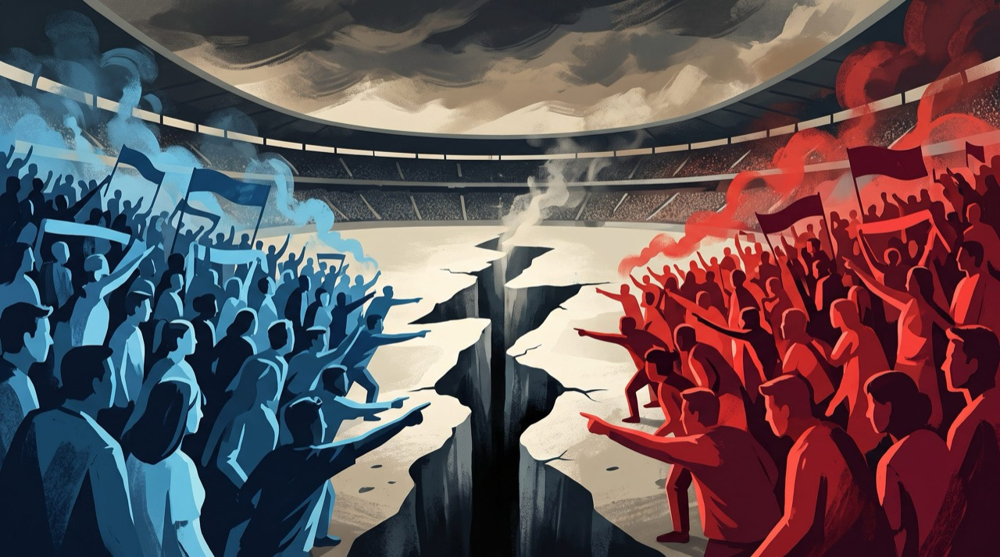

*"Tchê, de que lado tu estás? Ninguém pode agradar os dois lados", Humberto Gessinger*

> Tudo se resume a uma briga de torcidas\
> E a gente ali no meio, no meio das bandeiras\
> O jogo não importa, ninguém tá assistindo\
> E a gente ali no meio, no meio da cegueira\
> Tudo se reduz a um campo de batalha\
> E a gente ali no meio

> Tudo se resume a disputa entre partidos\
> Lama na imprensa, sangue nas bandeiras\
> A verdade passa ao largo, como se não existisse\
> E a gente ali no meio, como se não existisse\
> Tudo se reduz, a uma cruz e uma espada

**Vícios de Linguagem**, Humberto Gessinger.\
Engenheiros do Hawaii, Simples de Coração (1995).

Infelizmente, volto a essa canção dos Engenheiros do Hawaii a cada eleição. Gessinger a escreveu num ano marcado pela violência entre torcidas nos estádios e usou o confronto para falar de algo maior: a disputa política e os discursos fabricados para convencer, em que cada um é empurrado para um lado e a verdade acaba ficando à margem.

O voto virou camisa de time, e a conversa, mesmo entre amigos e familiares, se parece cada vez mais com uma discussão de arquibancada. Cada torcida sabe muito bem quem não quer no poder. Pouca gente consegue dizer para onde quer que o país vá.

Meu pai escreveu no grupo do WhatsApp da família uma reflexão sobre isso. Católico, com longa vivência na Igreja, ele reconhece a divergência entre direita e esquerda como legítima, porque a democracia existe justamente para que pessoas diferentes possam discordar sem se tornarem inimigas. O que o preocupa é **a política que deixa de disputar ideias e passa a buscar dominação**: a fusão entre poder político, econômico, judiciário e religioso, a fé usada como ferramenta de mobilização eleitoral e o governante tratado como escolhido por Deus para salvar a nação.

Por isso, antes de votar, meu pai diz avaliar o caráter, as propostas, o compromisso com a Constituição, o respeito às instituições e a capacidade de governar para todos, inclusive para quem pensa diferente. E termina com uma pergunta: **“O candidato está defendendo um projeto para o país ou um projeto de poder?”**

## O que a eleição realmente escolhe

Um [artigo publicado na Sigma Society](https://www.sigmasociety.net/article/em-quem-votar) ajuda a entender por que essa pergunta é tão difícil de responder. A autora parte de uma frase atribuída a Nelson Rodrigues, “*os idiotas vão liderar o mundo, não por sua capacidade, mas sim pelo número*”, e reconhece que ela simplifica a questão, mas toca num ponto real.

Ao longo da história, o poder raramente ficou com quem mais merecia ou sabia mais. O artigo mostra que ele fica com quem sabe mobilizar a maioria, por meio de **discursos superficiais**, **notícias falsas** e **mecanismos de influência social**, e que a forma mais eficiente de dominação talvez seja convencer as pessoas de que estão defendendo os próprios interesses enquanto servem aos de quem as conduz.

Um desses mecanismos é o [efeito manada](https://pt.wikipedia.org/wiki/Comportamento_de_manada), em que as pessoas seguem o grupo sem examinar as evidências, movidas pelo desejo de pertencer. Em contextos polarizados, ele ganha força porque o apoio político vira questão de identidade. Concordar com as ideias de um candidato deixa de bastar, e passa a ser preciso defender o grupo, rejeitar os adversários e tolerar as falhas dos aliados. É a torcida de Gessinger fora do estádio. A Alemanha, com toda a sua tradição científica e intelectual, não esteve imune à manipulação que levou à barbárie, e cabe perguntar por que um país com as deficiências educacionais do Brasil estaria mais protegido.

A alegoria do navio, no Livro VI de A República, de Platão, ajuda a enxergar o problema. Os marinheiros disputam o leme sem dominar a arte de navegar, enquanto o navegador de verdade, que conhece os ventos, é tratado como inútil. **Convencer a tripulação a entregar o comando é uma habilidade diferente de saber conduzir o navio**. A eleição mede diretamente a capacidade de obter votos e só indiretamente a capacidade de governar, o que abre espaço para quem tem talento retórico parecer competente sem nunca ter provado isso. E, como em A Revolução dos Bichos, de Orwell, quem chega ao poder com o discurso da justiça muitas vezes passa a reproduzir os privilégios que combatia, em qualquer regime.

O texto vai além e afirma que nenhuma democracia real existe no mundo, apenas oligarquias e plutocracias com esse nome. Fico num ponto menos radical, mas compartilho o incômodo e as saídas práticas que ele propõe: perguntar o que o candidato já fez, se cumpriu o que prometeu e se suas propostas têm consistência, usar a mesma régua para aliados e adversários e escolher o menos ruim quando nenhuma opção satisfaz.

Concordo com meu pai e com boa parte desse diagnóstico. Mas penso que falta uma peça nessa conversa.

## O navio sem rota

Mesmo o melhor navegador precisa saber para onde o navio vai. E o Brasil, a cada eleição, pode trocar o comandante e também o destino.

Cada presidente que assume define prioridades e ações de acordo com o próprio projeto, que quase sempre inclui **manter o poder e a influência do seu grupo**. O que foi prioridade num mandato perde força no seguinte, programas mudam de nome, obras ficam pela metade e o país recomeça com frequência demais. Nesse cenário, o eleitor fica sem uma referência comum para comparar o que cada candidato propõe, e a escolha volta para a arquibancada.

Planos de longo prazo, o Brasil já fez. Em 2020, o governo federal instituiu por decreto a [Estratégia Federal de Desenvolvimento 2020-2031](https://www.gov.br/gestao/pt-br/assuntos/gestao/estrategia-federal-de-desenvolvimento), com cinco eixos, índices-chave e metas para 2031. Em 2025, já sob outro governo, o Ministério do Planejamento começou a elaborar a [Estratégia Brasil 2050](https://www.gov.br/planejamento/pt-br/assuntos/planejamento/Brasil2050), com seminários regionais, consulta pelo portal Brasil Participativo e a meta de dobrar a renda per capita em 25 anos.

São dois planos de longo prazo em cinco anos, cada um nascido dentro de um governo e com a assinatura desse governo. Até o [Plano Plurianual](https://www.gov.br/planejamento/pt-br/assuntos/planejamento/plano-plurianual), previsto na Constituição brasileira, cobre quatro anos e avança apenas um ano sobre o mandato seguinte. Temos planos de governo com nome de plano de país.

Penso que o problema vai além da descontinuidade. Arrisco dizer que poucos brasileiros sabem que esses documentos existem, e menos ainda saberiam apontar quem é cobrado pelas metas que eles definem. Quando um plano é lançado com cerimônia, consulta e números ambiciosos, mas ninguém acompanha seus indicadores nem responde por eles, ele passa a cumprir outra função. Confere ao governo de turno a imagem de quem pensa no futuro, uma forma de legitimidade, enquanto as decisões reais continuam seguindo o calendário eleitoral.

Usado assim, o planejamento de longo prazo vira parte do mesmo projeto de poder que deveria limitar. O que nos falta é um pacto, com metas que pertençam ao país e uma prestação de contas que nenhum governo consiga engavetar.

## Um plano que pertença ao país

O que defendo é um plano de país para os próximos 15 ou 30 anos, construído pela sociedade como um todo. Isso significa reunir universidades e centros de pesquisa, tradições religiosas e filosóficas, entidades empresariais e de trabalhadores, organizações da sociedade civil, conselhos profissionais e forças políticas de todos os campos, cada um contribuindo com o conhecimento e a perspectiva que lhe são próprios. Desse processo sairia uma visão de futuro com objetivos, metas, indicadores e direcionadores estratégicos, aprovada de forma a sobreviver às trocas de governo e acompanhada por uma instância independente de quem governa.

A voz do cidadão também pode entrar nesse processo de forma direta. A população brasileira já escolhe seus representantes numa eleição que acontece em um único dia, com mais de 150 milhões de eleitores aptos, e em poucas horas conhecemos o resultado. Se temos essa capacidade tecnológica para escolher quem vai governar, por que não usá-la também para ouvir o que a população espera do rumo do país?

Até pouco tempo atrás, a única maneira de levar a vontade de milhões de pessoas a uma decisão nacional era delegá-la a representantes eleitos. Com a urna eletrônica, a internet e as plataformas de consulta, isso mudou. Hoje é possível ouvir a população em grande escala e com frequência, por plataformas digitais, pesquisas, audiências transmitidas e espaços de deliberação online, como o próprio [Brasil Participativo](https://brasilparticipativo.presidencia.gov.br/) já ensaia. Assim, a definição do rumo do país pode depender menos da intermediação partidária e mais daquilo que os cidadãos de fato querem para as próximas décadas.

Os presidentes e parlamentares eleitos trabalhariam em favor desse plano, e a representação política ganharia um papel mais nítido. Caberia a ela transformar a direção definida pela sociedade em execução, escolher os caminhos, conduzir os projetos, fiscalizar o uso dos recursos e acompanhar os resultados. A diferença entre esquerda e direita continuaria existindo, e deve existir, só que deslocada para o lugar certo, que é o **como fazer**. Dois governos de campos opostos podem perseguir a mesma meta de redução da pobreza ou de melhoria da educação básica por caminhos muito diferentes, com mais ou menos Estado, mais ou menos mercado e com prioridades e ritmos próprios. Cada um montaria seu plano tático de acordo com suas crenças, mas seria cobrado pelos mesmos indicadores e objetivos.

Quem trabalha com organizações reconhece essa lógica. Uma empresa saudável combina uma direção estratégica estável com liberdade para que cada equipe escolha como chegar lá. Quando a direção muda a cada nova liderança, o resultado costuma ser energia gasta em recomeços e pessoas que deixam de acreditar no rumo. Com países, desconfio que a dinâmica seja parecida.

## Há quem já faça isso

Alguns países, estados e cidades já experimentam mecanismos desse tipo, cada um a seu modo.

O País de Gales aprovou em 2015 a [Lei de Bem-Estar das Gerações Futuras](https://www.gov.wales/well-being-of-future-generations-wales). Antes dela, o governo galês conduziu durante um ano uma conversa nacional, chamada *The Wales We Want*, com pessoas, comunidades e organizações de todo o país. A lei fixou sete objetivos de longo prazo, obriga o governo a manter indicadores nacionais que vão além do PIB, com marcos de progresso e relatório anual, e exige que os órgãos públicos definam objetivos alinhados a ela e prestem contas. Criou ainda um **Comissário para as Gerações Futuras**, que acompanha e cobra o setor público em nome de quem ainda não nasceu.

A Escócia organiza a ação pública desde 2007 em torno de um [Quadro Nacional de Desempenho](https://www.gov.scot/collections/national-performance-framework/), lançado com 15 resultados nacionais e 45 indicadores. Em 2015, esses resultados passaram a constar em lei, que obriga o governo a submetê-los a consulta e a revisá-los a cada cinco anos.

A Finlândia mantém desde 1993 um [Comitê para o Futuro no Parlamento](https://unu.edu/cpr/blog-post/parliamentary-committees-future-legislative-movement-overcome-political-myopia), formado por 17 deputados. Pelo menos uma vez por legislatura, o governo apresenta um relatório sobre as perspectivas de longo prazo do país e suas metas, e o comitê prepara a resposta do Parlamento. O futuro passa a ser discutido como assunto de Estado, enquanto as opções ainda estão abertas.

A Irlanda lançou em 2018 o [Project Ireland 2040](https://www.gov.ie/en/department-of-public-expenditure-infrastructure-public-service-reform-and-digitalisation/campaigns/project-ireland-2040/), que combina um plano de ordenamento territorial com horizonte de cerca de 25 anos e um plano de investimentos de 115 bilhões de euros em dez anos. Em 2021, um novo governo de coalizão, com outro primeiro-ministro, renovou o plano de investimentos e o ampliou para 165 bilhões de euros até 2030, mantendo o Project Ireland 2040 como referência.

Cingapura mantém um [Plano Conceitual](https://en.wikipedia.org/wiki/Urban_planning_in_Singapore) de uso do território com horizonte de 40 a 50 anos, revisto a cada dez anos e desdobrado em planos diretores de 10 a 15 anos, revistos a cada cinco. É um exemplo de método mais do que de democracia, num país governado pelo mesmo partido desde a independência.

No Brasil, a cidade de Recife seguiu um caminho particularmente interessante, porque a iniciativa nasceu fora do governo. A ideia do [Recife 500 Anos](https://recife500anos.org.br/) surgiu num workshop organizado pela UFPE em 2012 e foi levada à campanha municipal daquele ano por instituições da sociedade civil, lideradas pelo Observatório do Recife. Anos depois, o plano foi coordenado pela Agência Recife para Inovação e Estratégia, ouviu mais de 5 mil pessoas em oficinas nas regiões da cidade, entrevistas, grupos focais e consultas, e teve sua primeira versão publicada em 2019 e uma segunda, revista, em 2022. O horizonte é 2037, ano em que a cidade completa 500 anos, com uma visão de futuro desdobrada em caminhos estratégicos, metas, indicadores e uma carteira de projetos. O próprio documento faz questão de dizer que não é um plano de governo, e em 2020 a candidatura que viria a vencer a eleição municipal assinou publicamente um compromisso com ele.

Na escuta direta do cidadão também há referências, e uma das mais conhecidas é brasileira. Em 1989, Porto Alegre adotou o [Orçamento Participativo](https://prefeitura.poa.br/smgov/orcamento-participativo). Todos os anos, os moradores definem as prioridades de investimento da cidade em assembleias regionais e temáticas e elegem os conselheiros que acompanham a execução. A ONU reconheceu a experiência como uma das melhores práticas de gestão urbana do mundo, e ela inspirou iniciativas semelhantes em outros países.

A [Suíça leva a consulta ao plano nacional](https://fr.wikipedia.org/wiki/Votations_f%C3%A9d%C3%A9rales_de_2026_en_Suisse). Os cidadãos podem votar até quatro vezes por ano, com uma média de 15 temas federais em cada votação. Uma proposta de mudança na Constituição vai às urnas se reunir 100 mil assinaturas em 18 meses. Uma lei aprovada pelo Parlamento pode ser submetida a referendo com 50 mil assinaturas colhidas em 100 dias.

A Irlanda mostrou como combinar deliberação e voto. Em 2016, o Parlamento criou uma [Assembleia de Cidadãos](https://electoral-reform.org.uk/the-irish-abortion-referendum-how-a-citizens-assembly-helped-to-break-years-of-political-deadlock/) formada por 99 pessoas sorteadas para representar a diversidade da sociedade irlandesa. Durante meses, essas pessoas ouviram especialistas e debateram o aborto, tema que travava a política do país havia décadas. Suas recomendações abriram caminho para o referendo de 2018, que mudou a Constituição. Antes disso, uma convenção semelhante já tinha preparado o referendo de 2015 sobre o casamento entre pessoas do mesmo sexo.

Taiwan talvez seja o caso mais avançado no uso da internet. Desde os protestos de 2014, governo e comunidades de programadores cívicos desenvolveram plataformas como o [vTaiwan](https://info.vtaiwan.tw/), para consultas abertas sobre temas complexos, e o [Join](https://join.gov.tw/aboutus/index/en_US), mantido pelo governo. No Join, qualquer proposta que reúna 5 mil apoios recebe uma resposta fundamentada dos órgãos responsáveis, e até 2022 a plataforma já tinha recebido quase 14 mil propostas. Na discussão sobre a regulamentação do Uber, mais de 4.500 cidadãos votaram em 145 opiniões numa ferramenta chamada [Pol.is](https://en.wikipedia.org/wiki/Pol.is). Ela mapeia os grupos de opinião e mostra os pontos em que concordam, o que oferece um antídoto parcial ao efeito manada.

Barcelona criou a [Decidim](https://www.decidim.barcelona/ca/), uma plataforma de participação de código aberto. Em 2023, ela tinha 106 mil cidadãos registrados, cerca de 7,6% dos moradores com 16 anos ou mais. Hoje, mais de 240 instituições usam a Decidim ou plataformas semelhantes, entre elas a Assembleia Nacional e o Senado da França.

Nenhum desses modelos caberia no Brasil sem adaptação. Também convém lembrar que planejamento de longo prazo já serviu a regimes autoritários, como os [planos quinquenais que a Coreia do Sul](https://pt.wikipedia.org/wiki/Milagre_do_Rio_Han) iniciou em 1962, sob o governo de um general que havia chegado ao poder por um golpe no ano anterior. Um plano de país só faz sentido se for construído democraticamente, revisto em intervalos definidos e acompanhado por instituições independentes. Sem isso, corre o risco de virar mais um instrumento do projeto de poder que pretende conter.

## O que muda no voto

Com um plano de país em vigor, a pergunta do meu pai ganharia forma prática. Defender um projeto para o país passaria a significar algo verificável: a quais metas o candidato se compromete, que caminho propõe para alcançá-las e que resultados entregou nos indicadores que pertencem a todos.

Perguntar o que o candidato já fez e se cumpriu o que prometeu deixaria de depender da memória de cada eleitor. Haveria uma régua comum para candidatos de qualquer campo, e a discussão ganharia um terreno compartilhado, com metas que todos reconhecem e caminhos diferentes que podem ser comparados por resultados.

Enquanto esse plano não existe, resta a cada um de nós fazer o exercício por conta própria: perguntar o que cada candidato propõe para os próximos quinze anos, além dos próximos quatro, e desconfiar de quem se apresenta como o único capaz de salvar o país.

Décadas depois, a canção de Gessinger continua atual porque o vício que ela descreve continua o mesmo. Discutimos com paixão de torcida quem vai segurar o leme e quase nunca para onde o navio deve ir. Depois da apuração, como diz meu pai, continuaremos vivendo juntos no mesmo país, quem venceu e quem perdeu. Um destino construído por todos seria a forma mais concreta de sair da arquibancada.
