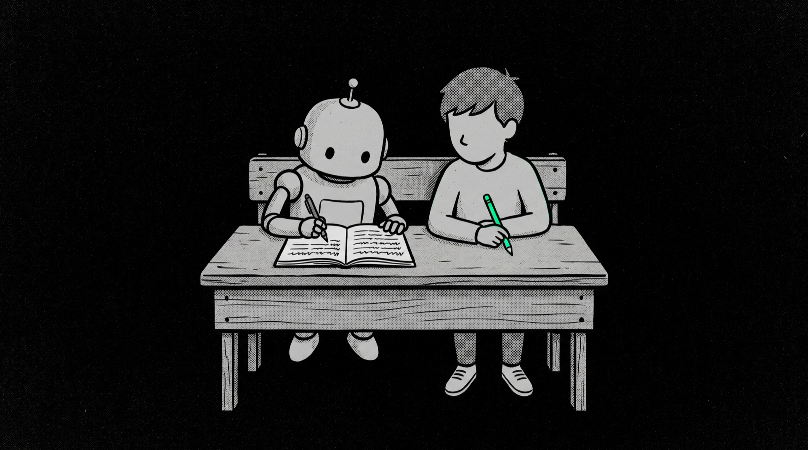
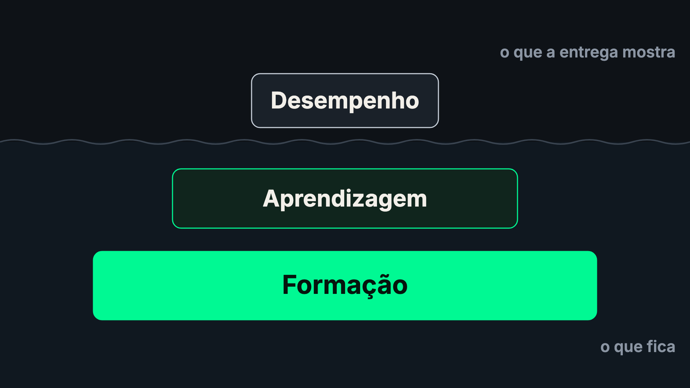
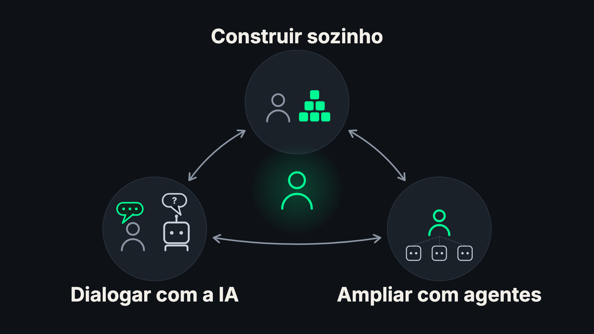

Durante muito tempo, a escola pôde confiar numa equivalência simples: quem fazia a tarefa aprendia com ela.

Aprender matemática envolvia resolver problemas. Aprender a escrever envolvia escrever. Para produzir uma boa redação, o estudante precisava pesquisar, selecionar informações, organizar ideias, construir argumentos e revisar o que tinha escrito. Cada etapa era uma oportunidade de desenvolvimento e o texto entregue era a prova de que o caminho tinha sido percorrido.

**A inteligência artificial desfaz essa equivalência**. Hoje um estudante consegue entregar uma ótima redação em minutos sem ter exercitado quase nada do que ela deveria desenvolver. A qualidade do resultado produzido por um estudante já não é necessariamente uma boa medida daquilo que ele sabe ou é capaz de fazer.

Há, porém, um paradoxo importante: **a mesma tecnologia que pode enfraquecer determinadas capacidades humanas também pode proporcionar oportunidades extraordinárias para desenvolvê-las**. A diferença está em como a usamos, em quando a introduzimos e, principalmente, em quais experiências de aprendizagem decidimos preservar.

Olho para essa questão de dois lugares. O primeiro é a [Escola Lumiar Poços de Caldas](https://www.escolalumiarpocos.com.br/), que ajudei a fundar em 2018. A escola segue a Metodologia Lumiar, que rompe com a seriação por idade e com o currículo dividido em disciplinas, organiza a aprendizagem em projetos acompanhados por Tutores e Mestres e tem a autonomia como o objetivo final da formação. O segundo lugar é a sala de aula de cursos de pós-graduação e MBA, onde ensino adultos que já chegam com anos de experiência profissional. A IA levanta a mesma pergunta nos dois lugares, mas com pesos diferentes.

## Fazer a tarefa e aprender com ela

Convém separar três coisas que a escola costumava tratar como uma só. Desempenho é conseguir realizar uma tarefa com qualidade. Aprendizagem é o que permanece depois que a tarefa termina. Formação é o que essas experiências produzem em autonomia, discernimento e valores.

*Aprendizagem e Formação estão muito além do Desempenho na era da IA*

Já existe evidência experimental de que as duas primeiras podem andar em direções opostas. Um estudo [publicado na PNAS em 2025](https://doi.org/10.1073/pnas.2422633122) acompanhou quase mil estudantes do ensino médio na Turquia em aulas de matemática. Quem praticou com uma interface parecida com o ChatGPT teve desempenho 48% melhor que o grupo sem IA durante os exercícios. Entretanto, quando a ferramenta foi retirada, esses mesmos estudantes foram 17% piores na prova. Um terceiro grupo usou um tutor configurado para dar pistas em vez de respostas e o efeito negativo foi em grande parte evitado, embora esse tutor também não tenha melhorado de forma significativa o resultado na prova sem IA.

Esse estudo mostra um risco específico: **trocar a atividade cognitiva de que a aprendizagem depende pela produção automática de respostas**.

A psicologia cognitiva estuda há décadas por que esse esforço importa. Henry Roediger e Jeffrey Karpicke mostraram que tentar recuperar um conteúdo da memória produz retenção mais duradoura do que simplesmente reler o material, fenômeno conhecido como *testing effect*. **Errar, reconstruir um raciocínio e explicar algo com as próprias palavras** parecem atividades pouco produtivas, mas são justamente as que ensinam.

O esforço formativo contribui para aprender, enquanto qualquer esforço desnecessário só gera frustração e consome tempo. A educação não precisa preservar toda a dificuldade, mas precisa preservar aquela que ensina.

## Delegar antes de saber

Transferir trabalho mental para ferramentas externas é um hábito antigo. Usamos agendas, calculadoras, mapas e mecanismos de busca (a literatura chama isso de *cognitive offloading*). A diferença da IA generativa está na amplitude da delegação: além de lembrar e calcular, ela interpreta, sintetiza, argumenta e formula conclusões.

Um profissional experiente, como os que encontro nas turmas de MBA, usa a IA para ampliar capacidades que já desenvolveu. Uma criança que usa IA antes de desenvolver essas capacidades corre o risco de criar dependência sem nunca ter construído a competência.

Um [estudo da Microsoft Research com a Carnegie Mellon](https://www.microsoft.com/en-us/research/wp-content/uploads/2025/01/lee_2025_ai_critical_thinking_survey.pdf), publicado em 2025 com 319 profissionais, encontrou **associação entre mais confiança na IA e menos pensamento crítico declarado nas tarefas assistidas**. São adultos relatando a própria percepção, o que não prova nada sobre crianças, mas indica um mecanismo plausível que merece investigação.

Há também um efeito sobre a metacognição: **a capacidade de reconhecer o que sabemos e o que ignoramos**. Quando uma pessoa enfrenta um problema sozinha, a dificuldade revela os limites do próprio conhecimento. Com a IA, o resultado pode aparecer antes dessa consciência. O estudante produz uma explicação convincente e passa a acreditar que entendeu o assunto, enquanto a distância entre a competência percebida e a competência desenvolvida cresce sem que ele perceba.

O mesmo raciocínio chega ao desenvolvimento moral. Imagine um adolescente que, depois de uma briga com um amigo, pergunta à IA quem está certo e o que deve responder. A ferramenta pode oferecer uma interpretação equilibrada e até sugerir uma mensagem cuidadosa. Receber uma resposta razoável, porém, é diferente de aprender a formar um julgamento próprio, que exige perceber o conflito entre valores, considerar a perspectiva do outro, tolerar a ambiguidade e assumir as consequências da decisão.

A filósofa [Shannon Vallor chamou de moral deskilling](https://bhaven.org/uploads/3/4/0/3/34038663/vallor2015_article_moraldeskillingandupskillingin.pdf) o enfraquecimento de capacidades morais quando a tecnologia substitui as experiências que as exercitam. Ela escreveu sobre isso em 2015, antes dos modelos generativos, mas reconhecia que a tecnologia também pode desenvolver novas competências morais. Temos fundamento filosófico para a preocupação, mas ainda **não temos evidência longitudinal de que conversar com IA prejudique o desenvolvimento moral das crianças**.

## O que dizem os argumentos contrários

Há bons argumentos na direção oposta. Muitas atividades escolares são executadas mecanicamente, como copiar páginas, repetir procedimentos já dominados ou produzir trabalhos apenas para cumprir requisitos. Se a IA elimina parte desse trabalho e o estudante usa o tempo liberado para comparar hipóteses e debater ideias, ele pode aprender mais. O que decide é o destino desse tempo.

A IA também pode fazer exatamente o que temíamos perder. **Usada como interlocutora socrática, ela questiona uma afirmação, pede evidência, apresenta uma interpretação contrária e aponta a inconsistência de um raciocínio**. Gregory Kestin e colegas [publicaram na Scientific Reports, em 2025](https://www.nature.com/articles/s41598-025-97652-6), um experimento com estudantes de física de Harvard em que um tutor de IA construído com princípios pedagógicos permitiu aprender mais, em menos tempo, do que a aula de aprendizagem ativa usada na comparação.

A revisão mais recente sobre o tema, [publicada pela Stanford SCALE Initiative](https://scale.stanford.edu/ai/evidence-base-review/evidence-base-ai-k12-november-review) em novembro de 2026, desenha um quadro coerente com os dois lados. **A IA parece mais promissora quando ajuda o estudante a entender um conteúdo novo, praticar e receber feedback, mas pode reduzir a aprendizagem quando é usada para terceirizar o trabalho**. A mesma revisão reconhece que ainda não se sabe se os ganhos persistem no longo prazo e que poucos estudos tratam de crianças e adolescentes.

Há ainda a questão do acesso. Uma criança sem apoio em casa ou sem professor particular pode ter explicações individualizadas a qualquer hora, e restringir a ferramenta em nome da autonomia pode prejudicar justamente quem tem menos recursos. Mas a desigualdade pode reaparecer de outra forma. Dois estudantes com acesso ao mesmo agente de IA podem tirar proveitos muito diferentes dele: quem já tem boa base sabe formular perguntas, desafiar respostas e verificar informações, enquanto quem tem formação frágil tende a aceitar o que a ferramenta apresenta. A IA pode, ao mesmo tempo, democratizar o acesso ao conhecimento e ampliar a desigualdade de autonomia intelectual.

O risco está menos na delegação de tarefas em si e mais na delegação de processos que o estudante ainda precisa experimentar para aprender.

## Um problema que vai além da escola

Há poucos dias, [escrevendo sobre o futuro do desenvolvimento de software](/artigos/o-futuro-do-desenvolvimento-de-software-na-era-da-ia/), deixei uma pergunta sem resposta. Profissionais sêniores são formados após anos fazendo o trabalho de júnior. Se esse trabalho vai para os agentes, como se forma o sênior?

A educação enfrenta a mesma pergunta em escala maior. Muitas competências foram desenvolvidas pela participação gradual em atividades de complexidade crescente, e automatizar integralmente as etapas iniciais elimina parte das experiências pelas quais os iniciantes aprendiam.

Os estudos de fatores humanos conhecem esse padrão há mais de quarenta anos. Em 1983, Lisanne Bainbridge descreveu as "ironias da automação": **quanto mais o sistema automatizado assume o trabalho, menos o operador pratica as habilidades de que vai precisar justamente quando o sistema falhar**.

Com a IA, essa ironia pode sair da sala de controle e alcançar a sociedade. É um possível problema de reprodução da competência: uma sociedade capaz de produzir resultados sofisticados pode tornar-se progressivamente dependente de sistemas que ela própria tem cada vez menos capacidade de compreender, verificar ou substituir.

Isso ainda é uma hipótese, especialmente num horizonte de décadas. Ela merece, porém, entrar desde já no desenho das escolas e das organizações.

## O que vale a pena preservar

Antes de discutir quais atividades devemos ou não delegar à IA, existe uma pergunta anterior:

> Que capacidades humanas queremos que as futuras gerações desenvolvam, mesmo quando já não forem estritamente necessárias para executar tarefas?

Pense na escrita. Talvez, em pouco tempo, uma pessoa consiga se comunicar bem a vida inteira sem nunca escrever sozinha um texto complexo. Ainda assim, vale aprender a escrever, porque escrever é também uma forma de pensar, organizar ideias, lidar com ambiguidades e construir uma voz própria. O mesmo vale para a matemática, a investigação científica e a argumentação. **Algumas competências podem deixar de ser economicamente necessárias para continuar a ser humanamente valiosas**.

Se o critério for apenas a utilidade prática num mundo automatizado, podemos acabar eliminando experiências fundamentais para o desenvolvimento humano. E há uma ironia nisso: quanto mais os agentes de IA decidirem, criarem e executarem por nós, mais importante pode se tornar a capacidade humana de compreender, questionar, escolher e assumir responsabilidade.

Na prática, isso pede uma escola que alterne de propósito três modos de aprender. No primeiro, **o estudante constrói capacidades próprias**: observa, escreve, investiga e resolve problemas por conta própria. No segundo, **aprende em diálogo com a IA**, que questiona, dá pistas e apresenta contra-argumentos, enquanto ele continua responsável pelo raciocínio e pelas conclusões. No terceiro, **usa agentes para pesquisar, automatizar e criar produtos complexos**, e concentra o esforço em definir o problema, avaliar alternativas e responder pelo resultado. A combinação depende da idade, do que o estudante já sabe e do objetivo de cada momento.

*O ciclo virtuoso da educação ampliada pela Inteligência Artificial*

A avaliação muda junto. Se o produto final já não prova o aprendizado, é preciso **observar o processo, a evolução dos argumentos, as escolhas feitas e a capacidade de levar o conhecimento para situações novas**. Um projeto pode usar IA em várias etapas e terminar com cada estudante explicando, sem ajuda, o que aprendeu, como mudou de opinião e quais decisões consegue justificar. Esse desenho é familiar para quem trabalha com aprendizagem baseada em projetos, como na Lumiar. A IA amplia as possibilidades, e o estudante continua vivendo a investigação, a colaboração e a decisão.

A grande questão da educação na era da IA talvez deixe de ser apenas como preparar os estudantes para um mundo em que as máquinas fazem cada vez mais coisas e passe a incluir como **formar pessoas capazes de preservar e desenvolver sua humanidade num mundo em que precisam fazer cada vez menos coisas por necessidade**.

Se uma criança tiver sempre à disposição uma inteligência capaz de responder às suas perguntas, resolver as suas dificuldades e orientar as suas decisões, que experiências precisaremos criar intencionalmente para que ela desenvolva a sua própria inteligência, o seu próprio julgamento e a sua própria consciência moral?
